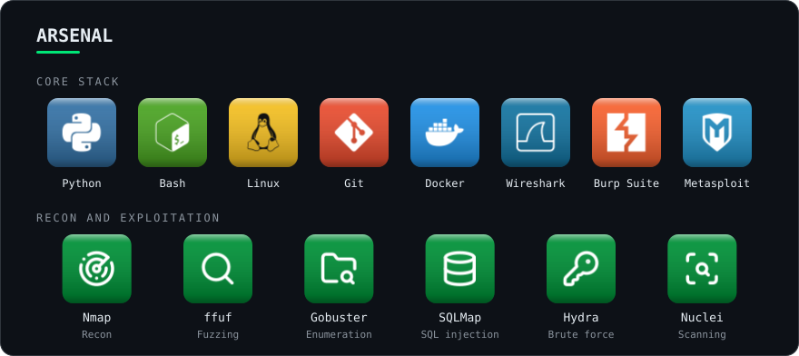
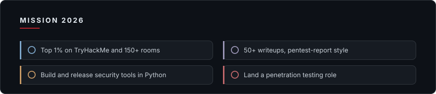

  

I'm a CPENT-certified penetration tester focused on web and API security. I sharpen my skills in hands-on labs, document my methodology in public writeups, and build Python tooling to speed up security workflows.

  

  

  

  
  
  
  
  
  

