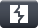

<h1 align="center">Welcome to my profile</h1>

  

  
  
  

I'm a CPENT-certified penetration tester focused on web and API security. I sharpen my skills in hands-on labs, document my methodology in public writeups, and build Python tooling to speed up security workflows.

---

## Arsenal

  
  
  
  
  
  
  
  

  
  
  
  
  
  

## Proof of work

  

- Top 4% on TryHackMe, 100+ rooms completed
- 37 published writeups: 32 TryHackMe and 5 Hack The Box
- All of them live in the CTF-Writeups repository:

  

## Activity

  

## Mission 2026

| Goal | Progress | Status |
|---|---|---|
| Top 4% on TryHackMe | `██████████` | ✅ Done |
| Writeups published | `███████░░░` 37 / 50 | 🔄 In progress |
| TryHackMe rooms | `███████░░░` 100+ / 150 | 🔄 In progress |
| Top 1% on TryHackMe | `░░░░░░░░░░` | 🔄 In progress |
| Build security tools in Python | `░░░░░░░░░░` 0 / 5 | ⬜ Planned |
| Active Directory attacks | `░░░░░░░░░░` | ⬜ Planned |
| Contribute to open source | `░░░░░░░░░░` | ⬜ Planned |
| Land a penetration testing role | `░░░░░░░░░░` | 🎯 Target |

## Get in touch

  
  
  
  
  
  

  <i>"Attackers think in possibilities. Defenders think in controls. Understanding both sides is where real security begins."</i>

